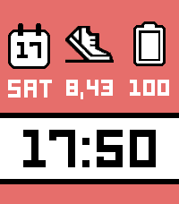
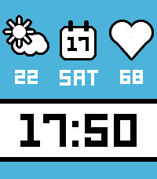
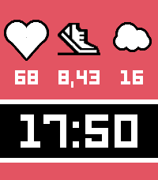
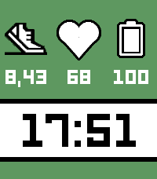
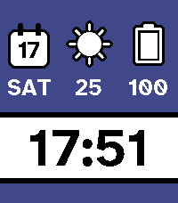
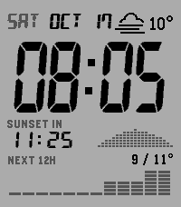
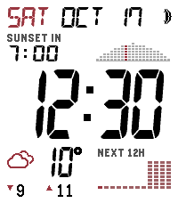
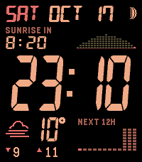
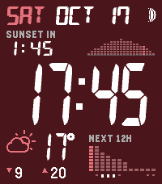
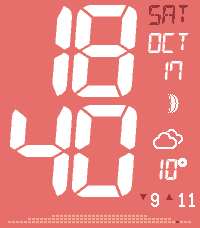

# aura-pebble

Watchfaces for the **Pebble Time 2** carrying the identity of **Aura**, my personal weather app for Spain (built on AEMET OpenData; the iOS and macOS app is `aura-apps`, the Android app is `aura-android`). Free and open source, distributed on the [Pebble appstore](https://apps.repebble.com/faces).

> "Pebble" here means [Core Devices](https://repebble.com), the 2025 relaunch, not the original 2016 company. The SDK and C API come from that lineage (PebbleOS is open source at [coredevices/pebbleos](https://github.com/coredevices/pebbleos)).

## Why this is its own project

Aura on the phone draws around 250 illustrated weather scenes over a live sky. A Pebble app gets about 128 KB of code and 256 KB of resources on a 200×228, 64-colour screen, so none of that art or logic ports. What carries over is Aura's design language: the weather-driven colour ramps (temperature, wind, air quality, UV) and the habit of showing one glanceable thing well. The faces here are standalone clocks in that language, and the weather watchapps and the LCD face take live weather from the phone.

## Faces

| Face | What it is | Status |
|------|------------|--------|
| **aura-essential** | A digital face in three blocks after the classic "Essential" layout: a top block with three configurable complications (steps, heart rate, battery, day of the week or weather) drawn as white icons with a black outline and flat segmented (LECO) numbers, a large clock centred in a white band, and a colour strip below. Every block colour, the separator and the clock font are configurable ([Settings](#settings)). | [Live on the appstore](https://apps.repebble.com/aura-essential_19335d2e746b4d6aa6ba8c63) |
| **aura-lcd** | A calm LCD face after the Casio CGW-50 "Cosmo Phase": sharp slanted 7-segment time, 14-segment LCD date, a sun path with the countdown to sunset or sunrise, the current weather with the day's low and high, and a 12 hour forecast of temperature and rain chance. After sunset it turns negative with amber digits. Three layouts (Quiet, Timeline, Stack), a day and a night look from the full 64-colour palette, and a worldwide city search ([Settings](#settings)). See [Design origin](#design-origin). | [Live on the appstore](https://apps.repebble.com/75df0aa5863e415eaa84c66b) |
| **aura-sky** | A weather **watchapp** where the sky is the interface: a full-bleed procedural sky painted from the real time of day and the current condition, with the temperature, hourly and daily pages. Live data from the phone (Open-Meteo worldwide, optional AEMET in Spain). See [`aura-sky`](aura-sky). | [Live on the appstore](https://apps.repebble.com/0a9a48594f2845d4a911ff41), [GitHub releases](https://github.com/mabaeyens/aura-pebble/releases/tag/sky-v1.0.1) |
| **aura-cityscape** | A weather **watchapp** where a small town is the interface: layered skyline, sun or moon on their real arc, lit windows after dark, clouds, rain, snow and lightning, a thermometer tower and a wind pennant, with hourly and daily pages in the same scene language. Live data from the phone (Open-Meteo worldwide, optional AEMET in Spain). See [`aura-cityscape`](aura-cityscape). | [Live on the appstore](https://apps.repebble.com/f96217ed9b8a41bfb25e2700), [GitHub releases](https://github.com/mabaeyens/aura-pebble/releases/tag/cityscape-v1.0.0) |

The Essential face on the Pebble Time 2 emulator, in five of its themes (every block colour and complication is configurable):

    

Aura Essential is live on the Pebble appstore at [apps.repebble.com/aura-essential](https://apps.repebble.com/aura-essential_19335d2e746b4d6aa6ba8c63). Install it straight to a Pebble Time 2 from the Pebble phone app.

The Aura LCD face on the Pebble Time 2 emulator, in its day and night looks and its Stack layout:

    

Aura LCD is live on the Pebble appstore at [apps.repebble.com/75df0aa5863e415eaa84c66b](https://apps.repebble.com/75df0aa5863e415eaa84c66b).

## Build and run

Needs the Pebble SDK (`pebble-tool`, installed with [`uv`](https://docs.astral.sh/uv/)):

```bash
uv tool install pebble-tool
pebble sdk install latest

cd aura-essential
pebble build                      # -> build/aura-essential.pbw
pebble install --emulator emery   # Emery = Pebble Time 2 (retry once if it says "Connection refused")
```

To run on a real watch, enable **Dev Connect** in the Pebble phone app, then `pebble install --cloudpebble`.

## Settings

The Essential and LCD faces each have a settings screen (open it from the Pebble phone app), built with [Clay](https://github.com/pebble-dev/clay). On aura-essential you choose what each of the three top complications shows, the colour of each block, the separator colour, and the clock font. On aura-lcd you choose the layout, the theme, the day and night colours, the date lettering, stroke weight, 12 or 24 hour time, units and the weather location.

Weather comes from [Open-Meteo](https://open-meteo.com), which needs no API key, so it stays free for anyone. The phone side (PebbleKit JS) fetches the current conditions for your GPS location, a city you search for, or a latitude and longitude you type in, and pushes them to the watch. The faces still work offline; the weather just reads empty until a reading arrives.

## Docs

- [`docs/PALETTE.md`](docs/PALETTE.md): Aura's colour ramps re-encoded to the 64-colour Pebble palette.
- [`docs/DISTRIBUTION.md`](docs/DISTRIBUTION.md): how a face gets published to apps.repebble.com.

## Design origin

The LCD face is a tribute to the Casio CGW-50 "Cosmo Phase". It is an independent, non-commercial reimplementation, not affiliated with or endorsed by Casio, and all code is original except where credited in [`aura-led-CGW-50/THIRD_PARTY_NOTICES.md`](aura-led-CGW-50/THIRD_PARTY_NOTICES.md). Casio and Cosmo Phase are trademarks of their owners.

The Essential face is a homage to the original [**Essential**](https://apps.repebble.com/essential_55cf75fc61e031bb4b000025) watchface for Pebble by **Kiezel**, on the appstore since 2015 and unmaintained since 2016: three blocks, white-icon complications with a black outline over a colour block, and a large segmented clock in a white band. The step-count shoe icon is reproduced from that face's own artwork; credit and thanks go to Kiezel. All the code here is original.

## Fonts

The Essential face draws its numbers in the Pebble system **LECO** font, and its weekday word in **LECO 1976 Regular** by Samuel Čarnoký (CarnokyType), the display face the system LECO is modelled on, which unlike the system font also carries letters. It is bundled and subset to the glyphs used under [`aura-essential/resources/fonts/`](aura-essential/resources/fonts). Unlike the other fonts it is not open-licensed: LECO 1976 Regular is offered free of charge on MyFonts under its Desktop and App licenses, which is how it is used here. The clock can also be set to **Atkinson Hyperlegible Next** (SIL OFL 1.1), a high-legibility face from the Braille Institute, bundled and subset the same way.

- LECO 1976 Regular, © Samuel Čarnoký / CarnokyType, free MyFonts Desktop + App license.
- Atkinson Hyperlegible Next, © Braille Institute of America, SIL OFL 1.1.

The LCD face draws its digits and its date lettering as polygons rather than from a font file. The digits come from the **7-Segment** font by Jan Bobrowski, by way of PT2-LCD221 by Kicou (MIT), and the 14-segment date letters are traced from **DSEG14 Classic Bold** by Keshikan. Its weather glyphs use the **Weather Icons** font by Erik Flowers. Licences and details are under [`aura-led-CGW-50/`](aura-led-CGW-50) (`THIRD_PARTY_NOTICES.md`).

- 7-Segment, by Jan Bobrowski, SIL OFL 1.1.
- DSEG14 Classic Bold, © Keshikan, SIL OFL 1.1.
- Weather Icons, © Erik Flowers, SIL OFL 1.1.
- PT2-LCD221 digit rendering, © Kicou, MIT.

## Built with

[Claude Code](https://claude.com/claude-code) (Anthropic).

## License

MIT. See [LICENSE](LICENSE).
