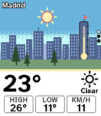
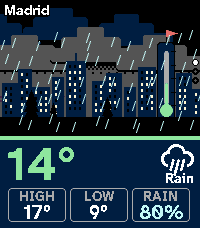
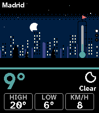
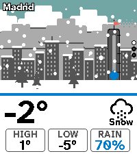
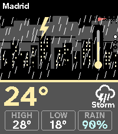
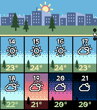
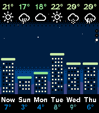

# Aura Cityscape Weather

A weather watchapp for the **Pebble Time 2** where a small town is the interface. The scene carries the data, and a plain panel below it carries the numbers. Free and open source, part of [aura-pebble](https://github.com/mabaeyens/aura-pebble). Targets `emery` only, written in C, with no baked art: every building, cloud and raindrop is drawn at runtime.

      

## What it shows

The time of day moves the sun or the moon along its real arc, from the sunrise and sunset times of the location, and swaps the palette of every layer (sky, far hills, town, ground) through night, dawn, day, golden hour and dusk. Windows light up after dark and in a storm. The condition shows as stepped pixel clouds at two speeds, a thick deck when overcast, a dithered fog, rain, snow caps on the roofs and the pines, and lightning. The temperature is the thermometer tower, its tube filled to the current temperature in Aura's colour ramp. The wind is the pennant on top of it, limp when calm, streaming out when strong, red from 50 km/h. The panel below carries the big number, today's high and low, and one more fact (rain chance when rain is likely, otherwise wind speed).

## Pages

UP and DOWN move between pages, SELECT asks the phone for a fresh forecast.

1. Hero: the animated scene and the panel. It moves for a few seconds at launch and whenever you shake your wrist, then holds still.
2. Hourly: a strip of the same skyline, then a 4 by 2 grid of little windows for the next eight hours. Each tile is painted in that hour's sky, with the hour, a condition glyph, the temperature and a rain-chance bar.
3. Daily: the next six days as a skyline. Each building's height follows that day's high, its roof is in the temperature colour, and the windows are lit after dark.

If no forecast has arrived yet (a fresh install, or the phone is out of reach), the app says so instead of showing made-up numbers. Once a forecast has been stored it stays on screen while the phone is away, and a small "3h ago" tag appears in the corner when it is more than two hours old.

## Settings

Open the settings from the Pebble phone app. Everything on the page does something.

1. Location: search a city by name (Open-Meteo geocoding), use the phone GPS (the default), or type a latitude and longitude. Picking a city switches GPS off.
2. Units: Celsius or Fahrenheit, or automatic from the phone's language. Wind follows (km/h or mph).
3. AEMET (optional, Spain only): use the official AEMET forecast for a location in Spain, with your own free key from opendata.aemet.es. If AEMET cannot be reached the app falls back to Open-Meteo.

## Data

The phone side (PebbleKit JS) fetches the forecast, digests it into a few small integers, and sends it to the watch in separate messages: the current conditions, eight hourly slots and six daily slots. It refreshes every 30 minutes while the app is open and when you press SELECT. The default source is [Open-Meteo](https://open-meteo.com), worldwide, with no account and no key. The watch never parses a forecast. The last forecast is stored on the watch, so the scene appears the moment the app opens.

## Design choices and limits

The town is one fixed skyline for every location. It is a deliberate choice for 1.0: a recognisable scene that stays the same, so the changes you read are the weather and the light. Wind direction is not shown, only speed. The thermometer scale is fixed from -5 to 40 degrees Celsius, so a very cold or very hot place pins to the end of the tube (the number beside it is always exact). The sky follows the sunrise and sunset of the forecast location, so a faraway city shows its own day or night, while the hourly page labels use the watch's clock.

## Build

```bash
export PATH="$HOME/.local/bin:$PATH"
pebble build                       # -> build/aura-cityscape.pbw
pebble install --emulator emery
```

The shipping build has no scripted data. To preview the scenarios on the emulator without a phone, set build-time switches (no source edit), and run `pebble clean` whenever you change them:

```bash
AURA_CITY_MOCK=1 AURA_CITY_TAG=1 AURA_CITY_SCENARIO=3 pebble build
```

`AURA_CITY_MOCK=1` compiles in eight scripted scenarios with a fake clock (SELECT steps to the next one, long SELECT to the previous one): 0 clear day, 1 golden hour, 2 rainy dusk, 3 clear night, 4 snow, 5 storm, 6 dawn fog, 7 overcast. `AURA_CITY_TAG=1` prints the scenario name in the corner, `AURA_CITY_SCENARIO=N` picks the one shown at launch, and `AURA_CITY_DEBUG=1` logs heap use and draw time. They are read by `wscript` and passed to the compiler as `MOCK`, `SHOW_MOCK_TAG`, `MOCK_SCENARIO` and `DEBUG_LOG`.

Other knobs sit at the top of `src/c/aura-cityscape.c`: the height of the scene, the thermometer range, how long each colour phase lasts around sunrise and sunset, the animation tick (`ANIM_MS`) and `SHAKE_TICKS` (how long a shake keeps it moving; 0 makes the hero static), and how far clouds and rain move per tick. Palettes are in `look_for()`, and the skyline is the `TOWN` table.

The store art is regenerated with `tools/make-icons.py` and `tools/make-banner.py` (Pillow).

## Fonts and licenses

The code is MIT, like the rest of the repository. Two fonts are bundled, both under the SIL Open Font License 1.1, and their license texts sit next to them in `resources/fonts/`: Atkinson Hyperlegible Next Bold (Braille Institute) for all text, and Weather Icons (Erik Flowers) for the condition glyphs. Both are subset to the characters the app uses.

## Design origin

Four existing apps on the Pebble appstore, among them Paper Diorama (a layered skyline with the text on a plain panel below) and Brandaris (lit buildings and a dithered sky), were the starting inspiration for a scene-first weather app. They were inspiration only. No code and no art was copied from any of them, and none of them is affiliated with or endorsed by this project. The town, the palettes, the clouds and every other drawing routine here are original.
