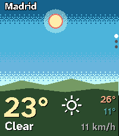
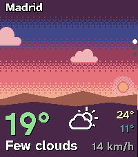
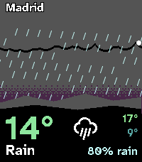
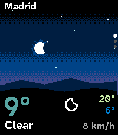
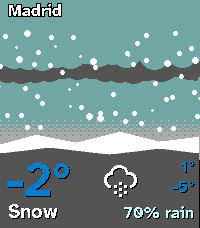
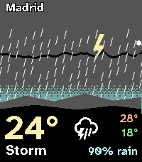

# Aura Sky Weather (Pebble)

A weather watchapp for the Pebble Time 2 where the sky is the interface. A full-bleed procedural sky is painted from the real time of day and the current condition, with one big temperature, a condition glyph, the day's high and low, and one second fact on a dark ground at the bottom. It targets `emery` only, is written in C, and has no baked art.

     

## What it does

The sky changes with two inputs the phone sends: the phase of the day (night, dawn, day, golden hour, dusk, worked out from the real sunrise and sunset) and the condition (clear, few clouds, cloudy, overcast, fog, drizzle, rain, heavy rain, snow, thunder). Colour bands are blended with an ordered dither, so there is no hard banding. The sun or the moon rides its arc across the sky, the moon is drawn at its real phase, clouds drift, rain falls and snow tumbles.

UP and DOWN move between three pages, SELECT refreshes, BACK exits.

- **Hero**: the sky, the sun or moon, clouds and precipitation, then the temperature, a condition glyph, the high and low, the condition word, and one second fact (chance of rain when it is likely, otherwise the wind). The only animated page. It moves for a few seconds at launch and whenever you shake your wrist, then holds still to save battery.
- **Hourly**: the next six hours as a strip of small skies, each painted as the sky will look at that hour, with the temperature trend drawn across them and a rain-chance bar underneath.
- **Daily**: six days of temperature ranges, with bars coloured by Aura's temperature ramp, over a dimmed copy of the current sky.

The last forecast is stored on the watch, so the app shows something the moment it opens. Until the first forecast arrives it says "No forecast yet" and why. If a refresh fails it keeps the stored forecast and marks it "3h old" once it is stale.

## Data

Weather comes from [Open-Meteo](https://open-meteo.com) through the phone, worldwide, with no account and no API key. In Spain you can optionally use the official [AEMET](https://opendata.aemet.es) forecast with your own free key; if AEMET does not answer, the app falls back to Open-Meteo. The watch only ever sees one small normalised forecast. The phone refreshes every 30 minutes while the app is open.

## Settings

Open the settings from the Pebble phone app (built with [Clay](https://github.com/pebble-dev/clay)). Every setting does something in this app.

- **Location**: search a city (worldwide typeahead), turn on phone GPS, or type a latitude and longitude. If GPS fails and no city is set, the app shows its no-forecast state instead of guessing a place.
- **Units**: automatic (phone locale), Celsius or Fahrenheit.
- **AEMET (Spain)**: optional switch and key.

## Known limits

The sky and the hour labels follow the watch's own clock and time zone. For the place you are in, that is exactly right. For a city in another time zone the sun times are matched by their clock hour, so the sky can be out of step with that city's real light.

## Build

```bash
export PATH="$HOME/.local/bin:$PATH"
npm install
pebble build                       # -> build/aura-sky.pbw (emery)
pebble install --emulator emery
```

Run `pebble clean` first whenever the `messageKeys` in `package.json` change.

### Preview builds

The shipping build uses real data. To preview the sky without a phone, build with scripted scenarios and a fake clock, selected by environment variables so no source edit is needed.

```bash
AURA_SKY_MOCK=1 pebble build                          # scripted scenarios
AURA_SKY_MOCK=1 AURA_SKY_SCENARIO=2 pebble build      # start on scenario 2
AURA_SKY_MOCK=1 AURA_SKY_TAG=1 pebble build           # also print the scenario name
```

In a mock build SELECT steps to the next scenario and a long press of SELECT to the previous one. The scenarios are in `src/c/data.c`: 0 clear day, 1 golden hour, 2 rainy dusk, 3 clear night, 4 snow, 5 storm, 6 dawn fog, 7 overcast. The mock code is always compiled and does nothing unless `MOCK` is 1. Run a plain `pebble build` again before shipping.

The store icons and banner are regenerated with `scripts/make-icons.sh` and `scripts/make-banner.sh` (ImageMagick 7).

### Knobs

At the top of `src/c/aura-sky.c`: `HORIZON_PCT` (sky against ground), the `DAWN_*`, `GOLDEN_BEFORE_MIN` and `DUSK_AFTER_MIN` phase lengths, `ANIM_MS` and `SHAKE_TICKS` (how long a shake keeps it moving; 0 makes the hero static), `CLOUD_DRIFT_PX`, `RAIN_FALL_PX`, `DITHER_ROWS`, `SUN_RADIUS`, `HOURLY_COLS`. Palettes are in `sky_stops()`, `ground_colors()` and `cloud_colors()`.

## Fonts and licenses

Text is set in Atkinson Hyperlegible Next Bold (SIL OFL 1.1, copyright The Atkinson Hyperlegible Next Project Authors) and conditions use the Weather Icons font (SIL OFL 1.1, copyright Erik Flowers). Both are subset to the glyphs used and bundled with their licenses in `resources/fonts/`. The code is MIT.

## Design origin

Several apps on the Pebble appstore, among them Brandaris, Weather Land and Paper Diorama, were inspiration for the idea of letting time and weather drive the whole background. No code or art was copied from any of them. The sky, the dithering, the clouds, the icons and the layout are original work, and the app is not affiliated with or endorsed by their authors.

Built with Claude Code.
